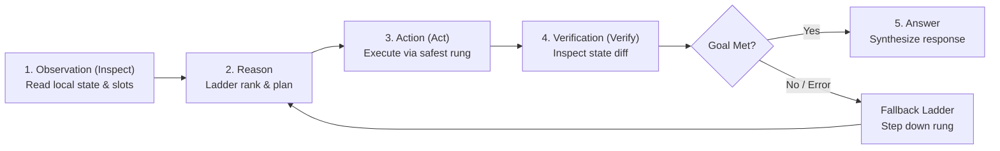

# Agent Reasoning Contract

> **Scope:** Defines the invariant operational contract for model reasoning, turn progression, error recovery, and tool execution in DoraX. Applies to all surfaces: Frontmost App Pets, Combined Chat, and General Chat.
> **Source of Truth:** Live implementation in `Context-Dock/AI/` (`AIProviderToolLoops.swift`, `AIToolBudget.swift`, `ScopedPromptAssembler.swift`, `PendingApprovalJournal.swift`, `AnthropicPromptCache.swift`) and `docs/superpowers/specs/2026-11-09-agent-harness-model.md`.

---

## 1. The Observation-Action-Verification (OAV) Invariants

Frontier coding and desktop agents (Claude Code, OpenAI Codex/Operator) do not execute commands blindly; they operate under a strict state verification loop. DoraX enforces five foundational invariants for every AI turn.



### Invariant 1: Ground Before Mutating (Observation Invariant)
The agent must never execute a state-mutating tool (writing a file, sending an email, clicking a destructive menu item, executing a shell command) without first inspecting the ambient state:
- **Filesystem actions:** Confirm file path, existing content, or folder contents via `read_file` or `FinderContextGrounder`.
- **App actions:** Ground against active window title, selected object ID, or frontmost document URL.
- **Context slots:** Derive `AppLiveDataContext` context slots (folder, sender, selection, document) before choosing an action.

### Invariant 2: The 5-Rung Execution Ladder (Fallback Invariant)
When choosing how to accomplish an intent, the agent **must strictly prefer the lowest-index rung** available. High-index rungs consume more tokens, take longer, and have higher failure rates.

| Rung | Execution Method | Token Cost | Failure Recovery Policy |
| :---: | :--- | :---: | :--- |
| **0** | **Solved Skill (Recipe)** | 0 tokens | If playback fails or app state changed, invalidate cached slot and fallback to Rung 1. |
| **1** | **Direct Headless Data** | Low | Native Swift connectors (`AppleLiveDataContext`, MCP, SQLite, Spotlight). If missing, fallback to Rung 2. |
| **2** | **AI Script (JXA / AppleScript)** | Moderate | Sandboxed script execution. On syntax or `-1728` error, inspect app dictionary or fallback to Rung 3. |
| **3** | **Menu Automation** | Low | On-demand menu search (`find_menu_command`) + `execute_menu_item`. If menu disabled/missing, fallback to Rung 4. |
| **4** | **Computer Use (Vision & AX)** | High | Sub-pixel coordinates or AX hierarchy navigation. Used only when no programmatic interface exists. |

### Invariant 3: Verification Post-Execution (Verification Invariant)
After executing an action on Rung 1–4:
- The agent must verify the intended side effect occurred (e.g. file exists, draft created, tab opened, AX element value updated).
- A tool execution reporting exit code `0` is necessary but not sufficient: the model must verify the semantic outcome before declaring success to the user.

### Invariant 4: Non-Destructive Actions & Undo Receipts (Reversibility Invariant)
- Destructive operations (`trash`, `overwrite`, `remove`, `kill`) must retain reversible state whenever possible.
- Solved skills and scripts executing mutations must generate an `UndoReceipt` detailing previous values or trash locations so the user can invoke `undo` in Settings or chat.

### Invariant 5: Explicit Approval Boundary (Gate Invariant)
- Operations classified as `requiresApproval: true` (sending emails, committing/pushing code, deleting directories, executing un-sandboxed shell scripts) must yield a `PendingApprovalRecord`.
- The approval record is written to disk via `PendingApprovalJournal` before any UI card is presented.
- The execution engine will refuse execution unless an `ApprovalExecutionReceipt` exists for the current turn ID.

---

## 2. Dynamic Turn Progression (`TurnFocus`)

DoraX eliminates model confusion and tool hallucination by categorizing all tools into focused phases via `TurnFocus` (`Context-Dock/AI/AIToolBudget.swift`):

```swift
public enum TurnFocus: String, Sendable {
    case inspect   // Read-only tools: get_context, read_file, search_messages, get_page
    case act       // Mutating tools: write_file, execute_script, execute_menu_item
    case verify    // Post-action checks: verify_file, get_element_state, diff
    case answer    // Final synthesis: summarize, cite, format response
}
```

### Round-by-Round Enforcement
1. **Round 1 (Inspect):** The model receives inspection tools. Mutating tools are filtered out unless the query is an unambiguous single-step macro.
2. **Round 2 (Act):** Once context is grounded, action tools are exposed along with applicable Rung 0–3 abilities.
3. **Round 3 (Verify):** Action execution triggers automatic transition to verification tools.
4. **Round 4 (Answer):** Once verification succeeds, tool exposure is trimmed to prevent runaway loops, and the model synthesizes its final response.

---

## 3. Loop Breakers & Error Recovery

To prevent infinite tool loops when third-party apps or OS states become non-responsive:

### No-Progress Loop Breaker
Implemented in `AIProviderToolLoops.swift` (`dorax.stop_reason = "no_progress"`):
- If the agent executes **two consecutive rounds** that produce identical tool outputs, or two consecutive rounds of identical error messages, the loop is terminated immediately.
- The model is forced into the `answer` phase with the prompt: *"The requested action could not be completed because the target app state did not change. Explain the current state and ask the user for guidance."*

### Standard macOS Error Code Traps
The agent is pre-conditioned to recognize standard macOS system errors:
- **AppleScript `-1728` (`errAENoSuchObject`):** The targeted UI element or document does not exist. Do not retry the exact same AppleScript. Step down to Rung 3 (`find_menu_command`) or inspect the open window titles.
- **AppleScript `-10004` (`errAEEventNotPermitted`):** TCC Automation permission denied. Inform the user and guide them to `System Settings ▸ Privacy & Security ▸ Automation`.
- **AXError `-25204` (`kAXErrorCannotComplete`):** The application is busy, frozen, or in modal sheet mode. Dismiss modal sheets before proceeding.

---

## 4. Prompt Assembly & Dual Caching Contract

To achieve Claude Code-level latency and token efficiency, `ScopedPromptAssembler` and `AnthropicPromptCache` enforce strict prompt ordering:

```
┌───────────────────────────────────────────────────────────┐
│ 1. Stable Prefix (Byte-identical across all turns)       │
│    • System persona & reasoning rules                     │
│    • App Pet Identity (com.apple.finder / Safari / etc.)   │
│    • Registered Capabilities & Solved Skills              │
│    • Available Native Tools & Schemas                     │
│    [CACHE BREAKPOINT 1]                                   │
├───────────────────────────────────────────────────────────┤
│ 2. Dynamic Ephemeral Context (Varies per turn)            │
│    • Active workspace path & git branch                   │
│    • Frontmost window & selection data                     │
│    • Conversation transcript history                      │
│    • Active TurnFocus state                               │
│    [CACHE BREAKPOINT 2]                                   │
└───────────────────────────────────────────────────────────┘
```

*Cache Invariant:* Changing the user's highlighted text or clicking a different file **must never invalidate Cache Breakpoint 1**. The stable prefix remains 100% byte-identical, resulting in up to 90% input token cost reduction and sub-second time-to-first-token.
