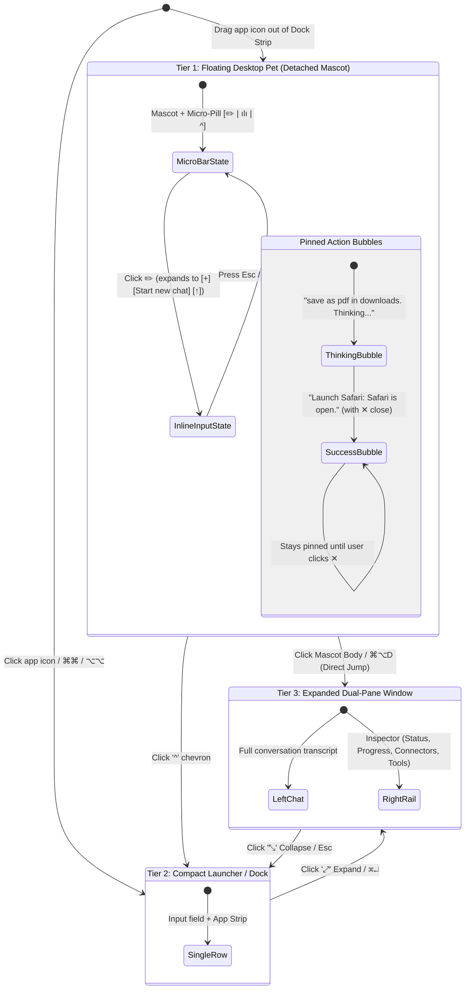

# DoraX Spec: Pet Presentation & Expansion Lifecycle

> **Status:** Owner-Approved UI/UX Architecture Specification (2026-10-28)  
> **Decisions Incorporated:**  
> 1. Mascot click/double-click jumps **straight to Tier 3 (Expanded Window)**.  
> 2. Action bubbles **stay pinned** until explicitly closed (`✕`) or hidden by the user.  
> 3. Micro-pill `✏️` expands in-place into an **Inline Pet Input Bar** (`[+] [Start new chat] [↑]`).  
> **Target:** Stage 5 (#342 Detached Pet Presentation) & Stage 1 (#338 Dock Scope Switching)

---

## 1. Executive Summary & Progressive Disclosure Flow

DoraX implements a **three-tier progressive disclosure model** for App Pets. The user can interact with an App Pet at three distinct depths—all sharing the exact same conversation history, per-app memory, and tool execution engine.

---

## 2. The Three Presentation Tiers

### Tier 1: Floating Desktop Pet (Detached Mascot)

A lightweight, non-activating floating AppKit panel (`NSPanel` with `.nonactivatingPanel` level `.floating` / `.popUpMenu`).

| Component | Visual & Behavior | Reference Screenshots |
| :--- | :--- | :--- |
| **Pixel Mascot Sprite** | Interactive sprite with reactive states:  • **Idle / Resting:** Calm eyes, occasional blinking.  • **Thinking / Working:** Wide awake, animated shimmer.  • **Completed / Happy:** Closed happy eyes with blush cheeks.  • **Direct Click:** Clicking or double-clicking the mascot jumps **directly to Tier 3 (Expanded Window)**. | Waterdrop sprite in idle and sleeping states |
| **Pinned Action Bubbles** | Stacked translucent frosted-glass pills directly above the mascot showing live execution progress:  • `Thinking`: Translucent state during LLM reasoning.  • `Action Receipt`: Green checkmark `✓ Launch Safari: Safari is open.`  • `Tool Execution`: `Save PDF to Downloads: Called js` with return `↩` and cancel `⏹`.  • **Persistence Rule:** **Bubbles stay pinned** permanently on screen until the user explicitly clicks the `✕` close button or hides them. | Top bubbles with `✕` dismiss and checkmarks |
| **Floating Micro-Bar** | Resting pill under mascot: `[✏️ Edit] [ılı Voice] [^ Expand to Launcher]`. | Compact pill at bottom of sprite |
| **Inline Pet Input Bar** | Clicking `✏️` expands the micro-bar in-place into a minimal text field:  `[+] [Start new chat] [↑]`  Allows instant command entry without opening any window. Pressing `Return` triggers task execution and returns the bar to micro state. | Expanded inline pill under sleeping mascot |

---

### Tier 2: Compact Launcher / Dock View

The standard Raycast-speed resting interface of DoraX (centered or bottom-corner placement):

| Component | Visual & Behavior |
| :--- | :--- |
| **Shell Dimensions** | Compact single-row bar: Scoped input (`"Ask Safari..."`) + `+` attachment button + Pet identity dropdown. |
| **Pet Strip** | Horizontal row of running apps. Clicking an app switches focus to that App Pet immediately without activating/foregrounding the underlying native app. |
| **Navigation** | • `⌘⌘` / `⌥⌥`: Toggle launcher visibility.  • `^` button on Desktop Pet: Opens this launcher anchored near the mascot.  • `⌘` on empty field / Backspace: Zooms out to Global Context. |

---

### Tier 3: Expanded Dual-Pane Window

The full diagnostic and conversational workspace:

| Component | Visual & Behavior |
| :--- | :--- |
| **Window Frame** | Liquid-glass translucent macOS window with controls: `[Book/Library]`, `[⤢ Expand/Collapse]`, `[Trash]`, `[Pin]`. |
| **Left Pane: Conversation** | Full message transcript, streaming responses, and permission prompts (e.g., `MCP tool create_tab requires approval`). |
| **Right Pane: Inspector Rail** | Live diagnostic and capability status:  • **App Status:** `Safari Ready`  • **Progress:** Current intent breakdown steps (e.g., *Resolving "new tab"*).  • **Connectors:** Active integrations (`safari-mcp`, AppleScript, CLI).  • **Can do here:** Live count of available tools, scripting rungs, and menu commands (`39 Menu commands`). |

---

## 3. Gestures & Transitions

1. **Drag-to-Detach (Dock Strip → Desktop Pet):**
   * Dragging any app icon from the Dock Strip out onto the desktop tears away with a spring animation and spawns the **Tier 1 Mascot** at the dropped coordinates.
   * Multiple detached Pets can coexist (e.g., Safari Pet and Mail Pet on opposite screen corners), each bound to their respective app conversation store.
2. **Repositioning:**
   * Clicking and dragging the mascot body moves it smoothly across displays; coordinates persist in macOS user defaults.
3. **Mascot Click → Tier 3 Direct Jump:**
   * Clicking the mascot opens the **Tier 3 Expanded Window** for that app immediately, restoring its conversation and Inspector Rail.
4. **Re-attaching / Closing:**
   * Closing the detached Pet via its menu or dragging it back into the Dock returns it to dormant status without losing chat history or verified memories.

---

## 4. Implementation Mapping (App Pets Staged Plan)

This specification fits directly into the roadmap:

* **Stage 1 (#338):** Pet identity and Dock scope switching (Tier 2 Launcher).
* **Stage 5 (#342):** Detached Pet presentation, pixel mascot window, pinned action bubbles, and inline input bar (Tier 1 Desktop Pet).
* **Single Harness Contract:** All tiers read and write through `AppScopedChatService`, `ApprovalCenter`, and `DockEngine`. UI view switching never duplicates background tasks or permissions.
