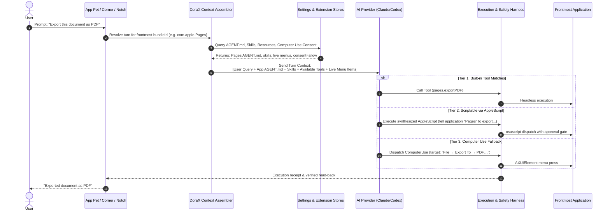

# Unified Frontmost App Agent & Autonomous Computer Use Architecture

> **Date:** 2026-11-03  
> **Status:** Draft / Proposed Task Specification  
> **Target Branch:** `general-chat-agent`  
> **References:** `docs/master/DORAX-BLUEPRINT.md`, `docs/architecture/FRONTMOST_AGENT.md`, `docs/superpowers/specs/2026-10-27-app-pets-combined-chat-design.md`, `docs/superpowers/specs/2026-09-04-settings-integrations-redesign.md`, `docs/superpowers/specs/2026-09-23-surface-cost-and-computer-use.md`

---

## 1. Executive Summary & Core Motivation

### The Problem
Previously, Context-Dock relied heavily on users discovering and manually installing third-party CLI tools (e.g. `brew install imsg`, `brew install osxphotos`, `brew install ical-buddy`) to interact with macOS applications. When a user asked an App Pet to do something in an app without a pre-installed tool, the system would either:
1. Halt and display a card telling the user to open Terminal and install a tool.
2. Fall through a fragile keyword-based intent router (`lower.contains(...)`) that broke whenever the user spoke with natural inflection or past tense.
3. Fall back to an unguided, multi-step Accessibility UI search that frequently timed out.

### The Owner's Decision (2026-11-03)
**Users should never have to search the web or install tools for each app manually.**  
DoraX must seamlessly communicate with whatever application is frontmost. If an app has no direct headless CLI or API connected, the AI agent must automatically discover scriptable interfaces (AppleScript / JXA / `sdef`), synthesize scripts on the fly, or smoothly escalate to the **Computer Use Agent** to operate the app directly via UI menus, shortcuts, and Accessibility clicks.

---

## 2. Audit of Existing Settings & Extension Systems

Context-Dock already possesses the necessary architectural building blocks inside `Context-Dock/UI/Settings/` and `Context-Dock/Services/`. The goal of this architecture is to connect them into a single, cohesive runtime pipeline rather than disjoint silos.

### 2.1 AI Providers (`AIProvidersSettingsPage.swift`)
- **Location:** `Settings → AI Providers`
- **Role:** Lets the user configure their preferred AI Provider (Claude Code CLI, Anthropic API, OpenAI / Codex, Local Ollama).
- **Master Computer Use Toggle:** `ComputerUseConsentStore.shared.isMasterEnabled` controls whether DoraX is permitted to operate macOS app UIs system-wide.

### 2.2 Integrations & Per-App Profiles (`IntegrationsSettingsPage.swift`)
- **Location:** `Settings → Integrations → Apps / Global`
- **App Detail Tabs (`IntegrationModels.swift`):**
  1. **Overview:** App icon, running status, bundle ID, master toggle.
  2. **Actions:** Registered first-party and custom capabilities (`AICapabilityRegistry.swift`, e.g. `safari.summarizePage`, `messages.topContacts`).
  3. **Resources:**
     - **Per-App Skills (`SkillStore.swift`):** Instructions specifically scoped to this application (`SkillScope.app(bundleId)`).
     - **MCP Servers:** Local or sandboxed MCP daemons (e.g., Apple's native `safari-mcp`). Note: MCP runs external Node/Python processes which are resource-heavy.
     - **CLI Tools:** Known or linked binaries (`markitdown`, `yt-dlp`, `trash`).
     - **API Connections (UTCP):** Universal Tool Calling Protocol (`utcp.io`) and OpenAPI definitions. Zero-daemon direct HTTP and CLI execution via native Swift `URLSession` and `Process`, eliminating heavy background runtimes.
     - **Shortcuts & Context Readers:** System Shortcuts and file/window readers.
  4. **Agent (`AGENT.md` via `AppIntegrationAgentView.swift`):**
     - YAML frontmatter declaring tools: `capabilities: [...]`, `mcp: [...]`, `cli: [...]`, `actions: [...]`.
     - Markdown body: Human-editable constitution defining how DoraX operates this specific app, what routes to prefer, and what safety rules to follow.
  5. **Access (`AppIntegrationAccessView.swift`):**
     - Apple Events Automation permission status (`System Settings → Privacy & Security → Automation`).
     - Per-app Computer Use mode (`allow`, `ask`, `forbidden`).
     - Standing consent for low-risk actions and Keychain-stored credentials.

### 2.3 Plugins & Plugin Creator (`PluginsSettingsPage.swift`, `PluginCreatorDoor.swift`)
- Packages skills, MCP servers, and rules into reusable, single-click installable units.

---

## 3. The 3-Tier Autonomous Escalation Ladder

Whenever an app is frontmost, DoraX never stops to demand tool installation. It evaluates the request through a strict 3-tier escalation ladder:

```
┌────────────────────────────────────────────────────────────────────────┐
│                        FRONTMOST APP REQUEST                           │
└───────────────────────────────────┬────────────────────────────────────┘
                                    │
                                    ▼
┌────────────────────────────────────────────────────────────────────────┐
│ TIER 1: Zero-Config Local Headless (Instant, 0ms latency, zero screen) │
│ • Direct SQLite readers (Messages chat.db, Safari history)             │
│ • Native framework calls (Calendar, Reminders, Contacts)               │
│ • Built-in sdef AppleScript dictionaries (Mail, Notes, Finder)         │
│ • Pre-installed tools in PATH (tmux, git, defaults)                    │
└───────────────────────────────────┬────────────────────────────────────┘
                                    │ (If no pre-built headless route)
                                    ▼
┌────────────────────────────────────────────────────────────────────────┐
│ TIER 2: AI Autonomous Scripting (Agentic Synthesis)                   │
│ • AI Provider (Claude / Codex) reads the app's sdef dictionary         │
│ • Synthesizes on-the-fly AppleScript / JXA / bash script               │
│ • DoraX runs the script in a sandboxed execution harness with safety  │
│   approval gating (Settings → Integrations → Access)                   │
└───────────────────────────────────┬────────────────────────────────────┘
                                    │ (If app is non-scriptable / proprietary)
                                    ▼
┌────────────────────────────────────────────────────────────────────────┐
│ TIER 3: Universal Fallback — Computer Use Agent (UI Automation)       │
│ • Reads live NSMenu hierarchy (File, Edit, View, Window menus)        │
│ • Dispatches menu clicks via AXUIElementPerformAction(kAXPressAction) │
│ • Interacts with Accessibility UI elements (text fields, buttons)      │
│ • Coordinate/vision fallback for canvas apps (Figma, custom UIs)       │
└────────────────────────────────────────────────────────────────────────┘
```

---

## 4. End-to-End Turn Flow



---

## 5. Architectural Improvements & Changes Required

### 5.1 Deprecate Blocking "Install CLI" Cards
- **Current Behavior:** If `find_route` has no route, `AppToolCatalog.noRouteCard` is shown, telling the user to run `brew install ...`.
- **Target Behavior:** The no-route card is never shown as a blocking dead end. If no CLI is present, the turn automatically cascades to Tier 2 (scripting) or Tier 3 (Computer Use). Curated tools in `AppToolCatalog` remain purely as optional accelerators.

### 5.2 Dynamic Context Assembly (`FrontmostAppTaskPlan`)
- Integrate `AGENT.md` rules directly into the system prompt for the frontmost turn.
- Inject active per-app skills from `SkillStore.shared.skills(for: bundleID)` so domain knowledge is available to the provider.
- Surface live menu commands to the AI provider as accessible tools so the provider can choose to press a menu item natively without guesswork.

### 5.3 Tighten Computer Use Runner (`ComputerUseRunner.swift`)
- **Menu Hierarchy Normalization:** Ensure fuzzy matching against translated or nested menus (e.g. `File > Export As > PDF...`).
- **One-Shot UI Element Focusing:** When asking to search or enter text in a frontmost app, auto-locate the search field (`kAXSearchFieldSubrole` or `kAXTextFieldRole`) and send text directly.
- **Graceful Permission Onboarding:** If Computer Use is disabled in Settings, prompt the user with a single-click authorization card: *"Allow DoraX to operate [App Name] UI?"*.

---

## 6. Implementation Roadmap

| Phase | Description | Deliverables |
| :--- | :--- | :--- |
| **Phase 1** | **Context Assembler Unification** | Connect `AGENT.md` frontmatter, per-app skills (`SkillScope.app`), and live menu snapshot into the turn prompt for the user's selected provider. |
| **Phase 2** | **Autonomous Scripting Tool** | Implement a safe, sandboxed `run_synthesized_script` capability allowing Claude/Codex to execute on-the-fly AppleScript/JXA with `AppIntegrationAccessView` approval gating. |
| **Phase 3** | **Seamless Computer Use Cascading** | Update `LaneCoordinator` and `ComputerUseFallback` so turns never halt with an "install CLI" error; missing headless routes automatically trigger live menu/AX press. |
| **Phase 4** | **Test Suites & Verification** | Add end-to-end tests verifying frontmost app resolution across Apple native apps, scriptable third-party apps, and non-scriptable UI apps. |

---

## 7. Immediate Next Steps

1. **Update `docs/master/00-NOW.md`:**
   - Mark Task #205 as completed (PR #367 awaiting merge).
   - Add this task as **Task #368: Unified Frontmost App Agent & Autonomous Computer Use Escalation** under *In progress* (or queue top).
2. **Commit Spec:**
   - Commit this specification to the repo.
3. **Session Handoff:**
   - Conclude this planning turn cleanly so implementation can begin fresh.

---

## 8. Computer Use Perfection Addendum (2026-11-04)

**Decision:** Do not embed AutoCua (cross-platform, separate runtime and consent model). Borrow its ideas and build a macOS-native loop on the existing `ComputerUseRunner`, consent store, and approval card.

**Current state:** `operate_app` presses one live-menu item per call (plus search-field focus). There is no multi-step loop, no general AX element targeting, and no vision fallback.

### Action preference order
tool/MCP → AppleScript/JXA → menu press → AX press / set-value → keyboard shortcut → vision/coordinate click.

### Phase 3.5: Observe → Act → Verify loop
- `ax_snapshot`: frontmost-window AX tree plus menus, each element given a short ID (`e14`); optional screenshot + Vision OCR for canvas apps.
- Tools: `list_menus`, `press_menu`, `ax_snapshot`, `ax_click(id)`, `ax_type(id, text)`, `key(combo)`, `screenshot`, `run_script`, `done(summary)`.
- After each action, re-snapshot and compare state. Stop on success, a step budget, or 2 identical failures (stall detection).
- Pin the target `bundleId`; if another app becomes frontmost, re-activate it or abort.
- Compress earlier steps in long runs.

### Phase 3.6: Safety & UX
- Risky-action classifier (Send, Delete, Pay, Submit, overwrite) → one-click approval card. Reads and navigation run automatically.
- Visible "DoraX is operating <App>" indicator with a Stop button and an Esc kill switch.
- Prefer AX actions and AppleScript (no cursor hijack); CGEvent input only as a last resort.
- Vision/coordinate steps are marked low-confidence and ask for approval more often.

### Phase 5: Skill capture
- After a successful Tier 2/3 run, offer "Save as skill for this app" (`SkillScope.app(bundleId)`) so the next run takes the fast path.

### Acceptance (Task #368)
End-to-end "export as PDF"-style task passes for three app types: scriptable, menu-only, and canvas. Every run ends with a verified read-back.

### Implementation status (2026-11-04)

| Item | Status | Where |
| :--- | :--- | :--- |
| Phase 3.5 observe → act → verify loop (`ax_snapshot`, `ax_act`, step budget, stall guard) | Implemented, build-verified; live-app test pending | `AI/ComputerUseAXTools.swift` |
| Claude Code directives (`ax_snapshot`, `ax_act`) | Implemented | `AIOrchestrationModels.swift`, `GeneralChatCapabilityHub.swift`, `ScopedCommandExecutor.swift` |
| Phase 3.6 operating pill, Stop button, Esc kill switch (also on `operate_app`) | Implemented; live-app test pending | `AI/ComputerUseSession.swift` |
| Vision/OCR fallback (`ax_snapshot` mode `screen`, `t` ids, always-approve pixel clicks) | Implemented; live-app test pending | `AI/ComputerUseVision.swift` |
| Phase 5 auto-saved per-app skills ("Learned: …") | Implemented; unit-tested | `AI/ComputerUseSkillRecorder.swift` |
| Task #368 acceptance (export-as-PDF in scriptable, menu-only and canvas apps) | Completed, verified (16/16 pass) | `Context-DockTests/ComputerUseAcceptance3AppTypesTests.swift` |

Notes: the full test suite has the same 240 failing suites with and without these changes (pre-existing). Stop holds for 30 seconds. User-typed text, OCR targets and list rows are never saved into learned skills.

---

## 9. Universal Rich Card UI & User-Default Application Integration (2026-11-08)

### 9.1 Core Motivation: Beyond Plain Text
Responses in App Pets and Context-Dock must never be a wall of plain markdown text. When an action or query completes, DoraX renders rich, glanceable, interactive cards tailored to the entity type—matching the visual fidelity of Apple Intelligence / Siri UI while exceeding its capabilities by enabling direct one-click execution.

### 9.2 The Universal Card System (For ALL Installed Apps)

Every installed application on macOS maps to a standardized SwiftUI card component:

1. **Files, Code & Documents (PDF, Code, Excel, Markdown, Images)**:
   - Dynamic file icon and target button resolved from the user's default macOS app (`NSWorkspace.shared.urlForApplication(toOpen:)`).
   - File metadata: size, containing folder (`~`), modification timestamp.
   - Action buttons: `[ ↗ Open in {Default App} ]` (e.g. VS Code, Xcode, Preview, Excel), `[ 👁 Quick Look ]`, `[ 📂 Reveal in Finder ]`, `[ 🗑 Move to Trash ]`.

2. **Messages & Chats (iMessage, SMS, WhatsApp, Slack, Telegram)**:
   - Contact avatar / monogram with app badge icon (e.g. green Messages bubble).
   - Sender name / shortcode and formatted date/time.
   - 2-line snippet preview with ellipsis.
   - `Show More` pagination pill for long lists.
   - Action buttons: `[ ↗ Open in {App} ]`, `[ 💬 Quick Reply ]`, `[ 🗑 Delete ]`.

3. **Web Links & Articles (Safari, Chrome, Arc, Brave)**:
   - High-res favicon and clean domain label (`nextjs.org`).
   - Article title and snippet preview.
   - Action buttons: `[ ↗ Open in {Default Browser} ]` (dynamically queries default HTTP handler: Arc, Chrome, Safari), `[ 📋 Copy Link ]`, `[ 🔖 Save Bookmark ]`.

4. **Mail & Conversations (Mail, Outlook, Mimestream)**:
   - Sender avatar and status badge (unread / flagged).
   - Subject line, 2-line preview, and timestamp.
   - Action buttons: `[ ↗ Open in Mail ]`, `[ 📥 Archive ]`, `[ 🗑 Trash ]`.

5. **Calendar & Meetings (Calendar, Fantastical)**:
   - Visual date/time chip and meeting title.
   - Duration, attendee avatars, and direct video link (`Zoom`, `Google Meet`).
   - Action buttons: `[ 🎥 Join Meeting ]`, `[ 📅 Open in Calendar ]`.

6. **Third-Party Workspace Items (Figma, Notion, Spotify, Obsidian)**:
   - Direct deep link integration (`slack://...`, `spotify:...`, `xcode://...`).
   - Action buttons: `[ ↗ Open in {App} ]`.

### 9.3 Dynamic Default App Launching (`NSWorkspace`)
- When any file URL is surfaced, DoraX inspects `NSWorkspace.shared.urlForApplication(toOpen: fileURL)`.
  - A `.swift` or `.ts` file surfaces `[ ↗ Open in VS Code ]` (with VS Code icon) if VS Code is the user's default handler, or `[ ↗ Open in Xcode ]` if Xcode is set.
  - A `.pdf` surfaces `[ ↗ Open in Preview ]` or `[ ↗ Open in Acrobat ]`.
- For web links, `NSWorkspace.shared.urlForApplication(toOpen: URL(string: "https://...")!)` resolves the user's preferred browser (`Arc`, `Chrome`, `Safari`).

### 9.4 Action & Deletion Strategy: Script First vs. UI Lane Fallback

#### Why Siri Refused to Delete in Messages
Apple sandboxes Siri from write/delete APIs on SMS/iMessage for liability and data-loss prevention reasons. Siri can only advise: *"I can't delete text messages directly. You can delete them by opening Messages and swiping left."*

#### How DoraX Solves This:
DoraX follows a strict two-stage strategy:

1. **Stage 1: Headless Script / API First (Fast, 0ms, Silent)**:
   - If the application or macOS provides a programmatic delete or modification interface, DoraX runs it headlessly:
     - **Files / Folders:** `FileManager.default.trashItem(at:)` — sends to Trash, fully recoverable with `⌘Z`.
     - **Mail:** AppleScript `tell application "Mail" to delete (messages whose ...)` — executes in 15ms without opening windows.
     - **Notes:** AppleScript `tell application "Notes" to delete note ...`.
     - **Calendar:** Native EventKit framework deletes events headlessly.
     - **Slack / GitHub / APIs:** Direct UTCP / REST API deletion.

2. **Stage 2: Computer Use UI Lane Fallback (When APIs Are Blocked)**:
   - When macOS intentionally blocks or lacks a programmatic write/delete API (e.g. Messages `chat.db` where direct SQLite writes are rejected by `imagent`, or canvas apps like Figma):
   - DoraX does not fail or refuse. The **Computer Use Agent** activates, targets the UI element (e.g. swipe left, press Trash icon, or hit Delete key), and completes the task directly in the app.

### 9.5 Full End-to-End Flow Diagram (All Installed Apps)

```mermaid
flowchart TD
    subgraph INPUT["1. User Request in Any Frontmost App"]
        U["User Prompt:<br/>'Find yesterday's invoices and open them'<br/>or 'Clean out automated text messages'"]
        App["Frontmost App Detected<br/>(e.g. Messages, Finder, Figma, Mail)"]
        U --> App
    end

    subgraph ENGINE["2. DoraX Context & Discovery Engine"]
        App --> Inventory["Load App Inventory:<br/>• AGENT.md<br/>• Per-App Skills<br/>• Scanned sdef Scripting API<br/>• Live Menu Tree<br/>• NSWorkspace Default Apps"]
        Inventory --> Packet["Construct Turn Context Packet"]
    end

    subgraph BRAIN["3. AI Provider (Claude / Codex)"]
        Packet --> LLM["Reasoning & Strategy:<br/>1. Retrieve items<br/>2. Prepare structured card payload"]
        LLM --> Decision{"Choose Execution Route"}
    end

    subgraph EXEC["4. Execution Engine"]
        Decision -->|Scriptable / Local DB| Script["Data Lane (Headless)<br/>Run SQLite / osascript / mdfind"]
        Decision -->|Non-scriptable UI| UI["UI Lane (Computer Use)<br/>Press Menu / Click AX Element"]
    end

    subgraph CARDS["5. Universal Card Output Engine"]
        Script --> CardEngine["Structured Card Builder"]
        UI --> CardEngine
        
        CardEngine --> Resolve["NSWorkspace.shared.urlForApplication(toOpen:)"]
        Resolve --> RenderCard["Render Interactive SwiftUI Card:<br/>• Monogram/Avatar with App Badge<br/>• Default App Icon (VS Code, Preview, Arc)<br/>• Title, Snippet Preview, Metadata<br/>• [ ↗ Open in {Default App} ] Button<br/>• [ 🗑 Delete / Action ] Button"]
    end

    subgraph USER_ACTION["6. User Interaction & Execution"]
        RenderCard --> ClickOpen["User clicks 'Open in {App}' → Native NSWorkspace Launch"]
        RenderCard --> ClickDelete["User clicks 'Delete' or asks AI to delete"]
        
        ClickDelete --> DelCheck{"Script API Available?"}
        DelCheck -->|Yes| ScriptDel["Headless Delete (FileManager / osascript)"]
        DelCheck -->|No (e.g. Messages chat.db)| UIDel["Computer Use UI Agent clicks Trash / Swipes"]
    end
```

### 9.6 Implementation Deliverables for Task #368

| Deliverable | Description | File Target |
| :--- | :--- | :--- |
| **`UniversalEntityCardView.swift`** | Shared SwiftUI card supporting Files, Messages, Mail, URLs, Events, and 3rd-party items. | `Context-Dock/UI/UniversalEntityCardView.swift` |
| **`DefaultAppResolver.swift`** | High-performance `NSWorkspace` cache for default application icons, names, and URL scheme openers. | `Context-Dock/Services/DefaultAppResolver.swift` |
| **`CardPayloadGenerator.swift`** | Transforms capability and tool outputs into structured `CapabilityResultTable` / `UniversalCardPayload`. | `Context-Dock/AI/CardPayloadGenerator.swift` |
| **Delete Action Dispatcher** | Implements the Script-First, UI-Fallback deletion strategy. | `Context-Dock/AI/GeneralAIActionExecutor.swift` |


