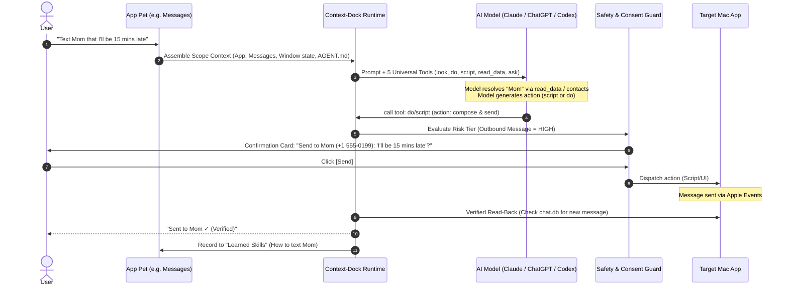

# Clean Universal App Agent Architecture: The 5-Tool Engine
> **Date:** 2026-11-04
> **Status:** Partially Shipped (PR #369: Messages/Mail/Notes/Safari capabilities + 5-tool external MCP bridge); model-facing tool consolidation superseded by 2026-11-09-agent-harness-model.md (H6 #413)
> **Target:** Universal Mac App Pets (`general-chat-agent`)  
> **Reference App #1:** Apple Messages (`com.apple.MobileSMS`)

---

## 1. Why Existing Mac Agent Apps Feel Perfect (And Why We Didn't)

When a user uses Claude Computer Use or modern agentic macOS assistants, it feels seamless and "smart." Why?

| Other Agentic Apps (Claude / ChatGPT Desktop) | Context-Dock (Previous Approach) |
| :--- | :--- |
| **Model is the Brain:** The model receives universal sensory tools (`look`, `do`, `script`) and decides what actions to take. | **Harness tries to be the Brain:** Complex keyword parsers (`actionWords`, `isActionRequest`, `readWords`) try to guess if a prompt is an action before the model even sees it. |
| **Tools are Always Available:** If an app is focused, the agent has its hands and eyes ready. | **Tools are Arbitrarily Withheld:** "turn on spelling" didn't match `actionWords`, so the harness withheld menu/AX tools and forced a "Direct response" text refusal. |
| **Model Synthesizes Scripts:** The model already knows AppleScript, JXA, and shell. It writes what is needed. | **Too Many Human-Configured Options:** 10 action types in "Add Action" (Deep Link, App, Shortcut, Prompt, Menu, AppleScript, JXA, Browser JS, Terminal, External Script). |
| **Clean Tool Surface:** ~4 to 5 intuitive tools. | **Tool Sprawl:** ~15 overlapping tools (`find_route`, `find_menu_command`, `run_menu_command`, `operate_app`, `ax_snapshot`, `ax_act`, `run_synthesized_script`, `run_app_script`, `run_capability`, `compose_message`...). |

### The Core Architectural Shift
> **The AI Model is the Brain. Context-Dock is the Safe, Native macOS Body.**
>
> 1. We do not starve the model of tools based on brittle string heuristics.
> 2. We do not ask users or developers to hand-configure 10 different action types.
> 3. We provide **5 clean tools** for every app pet.
> 4. We enforce **strict macOS safety, consent, and verified read-backs** so the model cannot cause damage.

---

## 2. The 5 Universal Tools

Every App Pet provides the model with the exact same 5 capabilities. No more, no less:

```
┌────────────────────────────────────────────────────────────────────────┐
│                        UNIVERSAL 5-TOOL SURFACE                        │
├─────────────┬──────────────────────────────────────────────────────────┤
│ 1. look     │ Observe the active app window: returns interactive UI    │
│             │ element IDs [e1, e2...] or live menu bar items.         │
│             │ Optional mode: "screen" for Vision OCR on canvas apps.   │
├─────────────┼──────────────────────────────────────────────────────────┤
│ 2. do       │ Act on an element or menu: click, type text, focus, or   │
│             │ press a keyboard shortcut.                               │
├─────────────┼──────────────────────────────────────────────────────────┤
│ 3. script   │ Execute synthesized AppleScript or JXA against the app.  │
│             │ Governed by macOS Apple Events permission & approval.    │
├─────────────┼──────────────────────────────────────────────────────────┤
│ 4. read_data│ Zero-latency headless data reader (e.g. Messages chat.db,│
│             │ Safari open tabs/history, Mail, Calendar, Notes).        │
├─────────────┼──────────────────────────────────────────────────────────┤
│ 5. ask      │ Ask the user for clarification, confirmation, or a       │
│             │ choice between ambiguous options.                        │
└─────────────┴──────────────────────────────────────────────────────────┘
```

---

## 3. The Execution & Safety Pipeline



### Safety Rules (Enforced by Native macOS Harness)
1. **Scope Pinning:** Every tool call is locked to the App Pet's `bundleIdentifier`. Cross-app calls from a pet are blocked.
2. **Outbound & Destructive Gates:** Actions that send messages, delete data, make purchases, or empty trash **always** trigger an approval card with the exact payload displayed.
3. **Emergency Stop (Kill Switch):**
   - Visible floating HUD: `"DoraX is operating [App Name] · Stop [esc]"`
   - Pressing **Esc** or clicking **Stop** immediately cancels execution and halts all agent actions for 30s.
4. **Verified Read-Back:** The agent never assumes an action succeeded just because a command ran. It verifies the state (via database query, file check, or fresh AX snapshot).

---

## 4. Phase 1 Reference App: Apple Messages (`com.apple.MobileSMS`)

Messages is our gold-standard test case. Once Messages is 100% reliable, the exact same harness powers every other Mac app.

### 4.1 Use Cases & Resolution Paths

| User Intent | Optimal Path | Fallback Path | Verification |
| :--- | :--- | :--- | :--- |
| **"Who messaged me last?" / "Read recent messages"** | `read_data(source: "messages.recent")` via direct SQLite read on `chat.db` | `look(mode: "elements")` to read visible conversation list in Messages window | Data returned from SQLite or window |
| **"Who do I talk to most?"** | `read_data(source: "messages.topContacts")` calculating frequencies across `chat.db` | None needed | Ranked list with real message counts |
| **"Text [Person] [Message]"** | 1. Resolve contact handle via address book<br/>2. Present approval draft card<br/>3. `script` (AppleScript: `tell application "Messages" to send ...`) | Open compose window and type via `do` | Query `chat.db` for sent message row (`is_from_me = 1`) within 5s |
| **"Search messages for [query]"** | `read_data(source: "messages.search")` | `do(focus: "search")` and type query | List of matching messages |
| **"Mute / Hide Alerts for this conversation"** | `do(menu: "Conversation ▸ Hide Alerts")` | `look` -> `do(click: [element_id])` | Fresh `look` confirms checkmark or mute icon |

---

## 5. Cleaning Up Legacy Tool & Intent Bloat

To achieve this clean architecture, the following legacy mechanisms are retired from the model-facing path:

1. **Remove Intent Keyword Filtering:**
   - Eliminate `actionWords`, `readWords`, and keyword-based tool withholding in `FrontmostAppTaskPlan.swift`.
   - The model in an App Pet always receives the 5 universal tools.
2. **Consolidate Model Tools:**
   - Deprecate individual model-facing tools: `find_route`, `find_menu_command`, `run_menu_command`, `run_adapter_action`, `run_capability`, `run_app_script`, `run_synthesized_script`.
   - Route all model actions through `look`, `do`, `script`, `read_data`, and `ask`.
3. **Simplify Settings "Add Action":**
   - Replace the 10-item menu with 3 simple options:
     - **Natural Language Goal** ("What should DoraX do?")
     - **Quick Link / Shortcut** (URL or Apple Shortcut)
     - **Custom Script** (AppleScript / JXA)
4. **Three-Tab Settings Page:**
   - **Can do:** Discovered & built-in capabilities, active skills, learned workflows.
   - **Rules:** App's constitution (`AGENT.md`).
   - **Access:** macOS permissions (Full Disk Access, Automation, Accessibility, Screen Recording).

---

## 6. Verification and Acceptance

A test suite of 10 standard prompts for Messages must pass consistently:
1. `Who messaged me recently?` -> Direct SQLite read, instant answer.
2. `Who do I message the most?` -> Top correspondents ranked list.
3. `Text [Contact] [Message]` -> Contact lookup -> Approval card -> Send -> Verified in `chat.db`.
4. `Turn on [Setting] / Toggle [Setting]` -> Look at menus/window -> Click element -> Verified.
5. `Search messages for [Keyword]` -> Accurate search results returned.
6. `Emergency Stop (Esc)` -> Immediately aborts in-flight actions.
